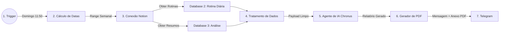

# Fluxo Geral

[Diagrama](../mermaid/fluxo-geral.mmd)

---

## 🛠️ Detalhamento das Etapas

### 1. Trigger (Disparo)
* **Frequência:** Semanal, executado **todo domingo às 11:50**.
* **Intervalo de Análise:** A semana anterior completa, cobrindo de **domingo passado até sábado (dia imediatamente anterior)**.

### 2. Cálculo Dinâmico de Datas (Ponto de Atenção)
* **Função:** Nó de código (JavaScript/Code Node) executado antes da busca no Notion.
* **Objetivo:** Calcular dinamicamente as variáveis de data inicial (`start_date`) e data final (`end_date`) formatadas (ISO 8601 / `YYYY-MM-DD`) para garantir que o filtro traga estritamente a semana correta sem puxar históricos desnecessários.

### 3. Conexão e Busca no Notion (Estrutura Multi-Database)
A busca realiza a extração do range de datas em **dois databases distintos**:
* **Database 2 (Rotina Diária):**
  * **Retorno:** Múltiplos itens (todas as atividades individuais da semana).
  * **Foco de Análise:** Tarefas programadas, horários, status de conclusão (`Concluído: Sim/Não`) e o **campo de texto "Observações"** (anotações de exceções e desvios).
* **Database 3 (Análise):**
  * **Retorno:** **7 itens** (um item consolidado para cada dia da semana).
  * **Foco de Análise:** Métrica de produtividade do dia, dados utilizados para os gráficos e o **Resumo Diário registrado na página**.

### 4. Tratamento e Limpeza de Dados (Nó Intermediário)
* **Função:** Filtro e formatador de JSON (Item Lists / Code Node).
* **Objetivo:** Limpar a estrutura bruta da API do Notion, extraindo apenas o payload relevante para a IA, otimizando o consumo de tokens e evitando alucinações.
* **Saída esperada:** Um JSON consolidado unindo as tarefas do Database 2 com seus respetivos resumos diários do Database 3.

### 5. Agente de IA (Chronus)
Processa o histórico e calcula duas métricas fundamentais:
* **Produtividade Pura:** Porcentagem fria de tarefas marcadas como concluídas no Database 2.
* **Produtividade Real:** Cálculo qualitativo baseado na leitura das **Observações (DB 2)** e do **Resumo Diário (DB 3)**. A IA identifica se uma tarefa deixou de ser feita porque foi substituída por outra necessidade real, ajustando a métrica sem penalizar o usuário.

**Output da IA:**
1. **Resumo Geral da Semana** (visão macro).
2. **Brechas de Procrastinação & Pontos de Falha** (horários ou padrões recorrentes de baixa execução).
3. **Feedbacks Positivos** (reconhecimento de constância).
4. **Sugestões e Ideias de Melhoria** para a próxima semana.

### 6. Geração do Documento PDF
* **Função:** Nó de conversão (HTML to PDF / Markdown to PDF).
* **Objetivo:** Receber a análise completa formatada em Markdown gerada pela IA e converter em um arquivo PDF binário para ser anexado ao envio.

### 7. Telegram (Entrega)
* **Destino:** Grupo do Telegram configurado com **Tópicos (Supergrupo)**.
* **Configuração do Nó:**
  * **Chat ID:** ID numérico do grupo (ex: `-100xxxxxxxxxx`).
  * **Message Thread ID:** ID específico do tópico/canal criado para o bot.
* **Entrega final:** Mensagem formatada no tópico informando a conclusão da análise + arquivo **PDF** anexado.